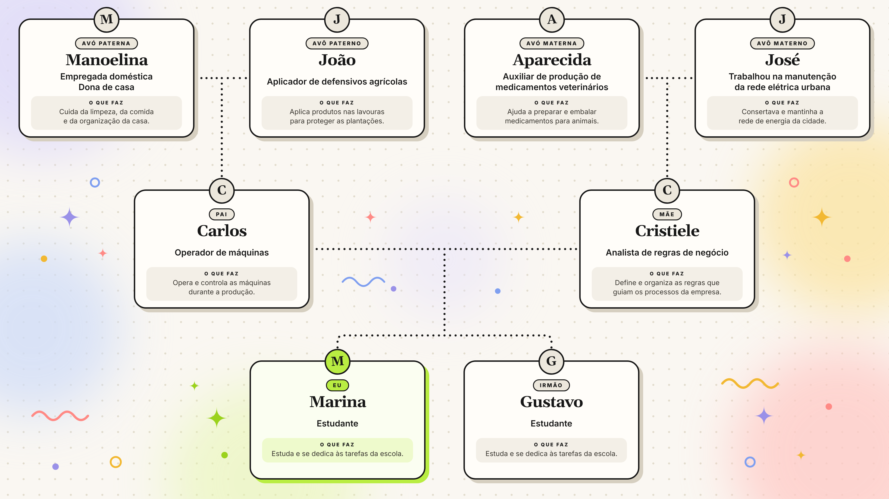

# Árvore Genealógica da Família (Membros Mais Próximos)

Um projeto visual desenvolvido para representar a estrutura familiar de forma organizada, criativa e ilustrativa, apresentando os integrantes da família, seus graus de parentesco, profissões e atividades.

## Sobre o projeto

Esta árvore genealógica foi criada com o objetivo de representar visualmente as relações familiares, facilitando a identificação das gerações e dos vínculos entre seus integrantes.

O projeto segue a identidade visual do meu portfólio: fundo creme com grade de pontinhos, cartões individuais com bordas marcadas e sombra deslocada, e detalhes coloridos de fundo. A cor de destaque, o verde, é usada apenas no cartão da Marina, que é a estudante.

## Estrutura familiar

A árvore está organizada em três níveis, com uma linha por geração:

### Avós
- **Manoelina** — Avó paterna.
- **João** — Avô paterno.
- **Aparecida** — Avó materna.
- **José** — Avô materno.

### Pais
- **Carlos** — Pai.
- **Cristiele** — Mãe.

### Filhos
- **Marina** — Eu.
- **Gustavo** — Irmão.

## Identidade visual

- **Paleta de cores:** creme, tons neutros e verde de destaque (só para a Marina), com manchas suaves em lilás, amarelo, azul e rosa no fundo.
- **Tipografia:** nomes em fonte serifada e textos em fonte sem serifa, como no portfólio.
- **Elementos gráficos:** estrelas, ondinhas, argolas e bolinhas decorativas.
- **Organização:** cartões individuais com bordas arredondadas, inicial do nome, etiqueta de parentesco, profissão e a caixinha "O que faz".
- **Conexões:** linhas pontilhadas ligando os casais (Manoelina e João, Aparecida e José, Carlos e Cristiele) e descendo até os filhos.

## Profissões e atividades

Cada integrante possui uma identificação com sua profissão ou ocupação e uma breve descrição do que faz.

| Integrante | Profissão/Ocupação |
| :--- | :--- |
| Manoelina | Empregada doméstica e dona de casa | 
| João | Aplicador de defensivos agrícolas | 
| Aparecida | Auxiliar de produção de medicamentos veterinários | 
| José | Trabalhou na manutenção da rede elétrica urbana | 
| Carlos | Operador de máquinas | 
| Cristiele | Analista de regras de negócio | 
| Marina | Estudante | 
| Gustavo | Estudante | 

## Objetivo

Representar a história e a composição familiar de maneira visual, valorizando os laços entre as gerações e apresentando um pouco da trajetória e das atividades de cada integrante.

## Resultado Final

 Resultado final da Árvore das Profissões (Membros Mais Próximos).

---

**Feito com carinho 💜**

*Família: nossas raízes, nossa história e nossas conexões.*

